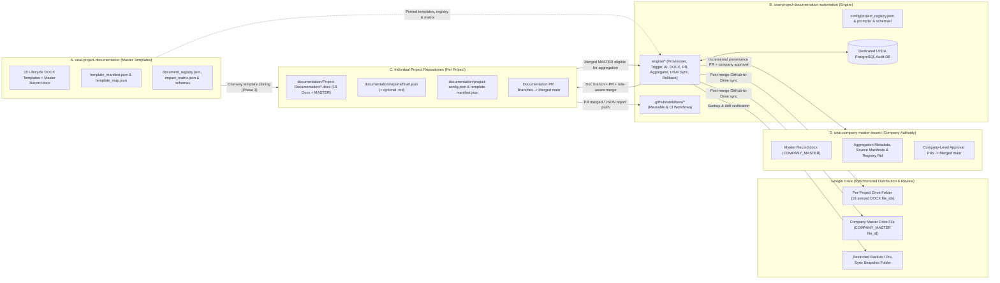
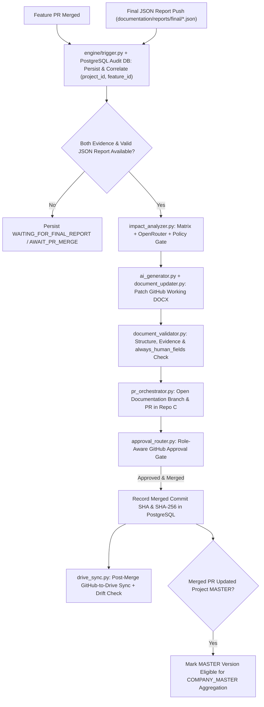

# UTDA Architecture (`GITHUB_AUTHORITY` + `BOTH` Master Records)

## 1. Fixed Architecture Decisions

1. **Decision A — Master Record Scope = `BOTH`:**
   - **Project-Level Master Record (`MASTER`):** Every registered project maintains its own `documentation/Project Documentation/Master Record.docx` inside its application repository, tracking project scope, milestones, features, architecture, status, risks, testing, releases, and project history.
   - **Company-Wide Master Record (`COMPANY_MASTER`):** A dedicated `unai-company-master-record` repository maintains UNAI Tech's single consolidated `Master Record.docx`, incrementally aggregated from approved, merged project-level `MASTER` records with explicit commit SHA, version, timestamp, and evidence provenance. Neither replaces the other.
2. **Decision B — Document Authority = `GITHUB_AUTHORITY`:**
   - **GitHub is the authoritative source of all UTDA documentation.**
   - **Google Drive is a synchronized distribution and collaboration destination only**—never the authoritative repository.
   - DOCX updates are generated and validated in GitHub documentation branches, reviewed via GitHub PRs with role-aware approvals, and **only after an approved PR is merged** synchronized to Google Drive.
   - Out-of-band Drive edits are detected as **drift**, never accepted automatically, and require an explicit reconciliation workflow. A Drive sync failure never reverses or invalidates a merged GitHub PR.
3. **Canonical Report Format:** JSON at `documentation/reports/final/<feature-id>.json` validated against [schemas/feature_report.schema.json](file:///c:/Users/kamal/OneDrive/Desktop/utda_starter/schemas/feature_report.schema.json) (with optional `<feature-id>.md` companion).
4. **Persistent Audit Database:** Dedicated UTDA **PostgreSQL** database enforcing transactional state, idempotency constraints, approval records, sync status, drift detection, and rollback history.

---

## 2. Four-Repository Logical Topology

---

## 3. GitHub-First Documentation & Sync Flow

---

## 4. Role-Aware Approval Matrix (Section 7)

| Scope / Document Class | Approval Requirement | Notes |
| --- | --- | --- |
| Routine technical documentation | Auto-publish (auto-merge doc PR) **only** when evidence, validation & policy checks pass | Blocked if `UTDA_DRY_RUN=true` or `never_auto_approve` |
| Functional requirements (`D03`, `D05`) | PM / PO approval (`pm_or_po`) | Enforced before PR merge |
| Sprint plan changes (`D09`) | PM approval (`pm`) | Enforced before PR merge |
| Architecture changes (`D07`, structural `D06`) | CTO or authorized technical lead (`cto_or_tech_lead`) | Enforced before PR merge |
| Project Charter baselines (`D01`) | Authorized human (`authorized_human`) | Listed in `never_auto_approve` |
| UAT sign-off (`D12`) | Authorized human (`authorized_human`) | Feature PR merge never implies UAT sign-off |
| Deployment & Go-Live (`D13`, `D14`) | Authorized human (`authorized_human`) | Feature PR merge never implies deployment/go-live |
| Project Master Record (`MASTER`) | Policy-based; restricted sections (`3`, `4`, `6.3`, `7`) require human approval | Listed in `never_auto_approve` |
| Company-wide Master Record (`COMPANY_MASTER`) | Authorized company-level reviewer (`company_reviewer`) | Separate PR in `unai-company-master-record` |

Every approval record stores `project_id`, `document_id`, `section_id`, `change_id`, `approver_identity`, `approver_role`, `decision`, `timestamp`, and `evidence_reference` (validated by [schemas/approval_record.schema.json](file:///c:/Users/kamal/OneDrive/Desktop/utda_starter/schemas/approval_record.schema.json)).

---

## 5. Google Drive Synchronization & Drift Handling

- **Direction:** Strictly **GitHub -> Google Drive** after PR merge.
- **Drift Detection:** Before uploading a merged GitHub DOCX, `drive_sync.py` checks Drive `version`/`md5Checksum` against the last recorded sync in PostgreSQL. If Drive was modified out-of-band since the last GitHub sync, automation **halts sync for that file**, marks `DRIFT_DETECTED` in PostgreSQL, and requires explicit human reconciliation—never silently overwriting newer GitHub versions or auto-accepting Drive edits.
- **Fault Isolation:** A Drive sync failure logs `SYNC_FAILED` and triggers safe retries, **without** reverting or invalidating the merged GitHub commit.
- **Rollback:** `rollback.py` uses GitHub commit history + PostgreSQL revision/checksum records + restricted Drive backup snapshots to restore either a GitHub documentation commit (via revert PR) or a Drive sync target on the same `file_id`.
