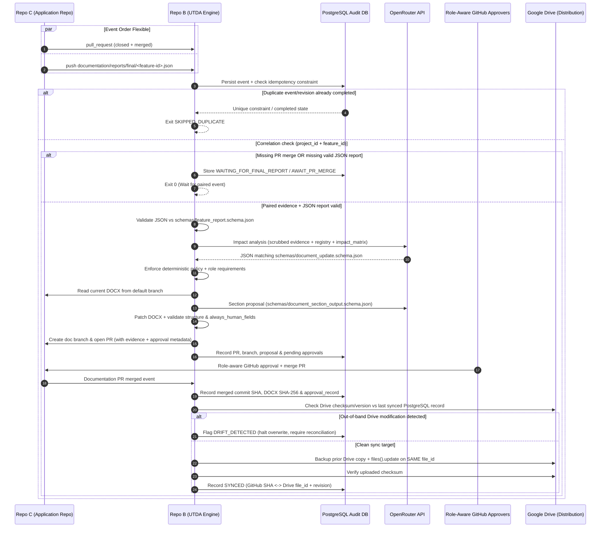

# UTDA Data Flow Specification (`GITHUB_AUTHORITY` + `BOTH`)

## 1. Document Update & Post-Merge Drive Sync Flow



---

## 2. Project-to-Company Master Record Aggregation Flow

```mermaid
sequenceDiagram
    autonumber
    participant RepoC as Repo C (MASTER Merged)
    participant DB as PostgreSQL Audit DB
    participant Agg as Repo B (master_aggregator.py)
    participant RepoD as Repo D (unai-company-master-record)
    participant CompRev as Company-Level Approver
    participant Drive as Drive (COMPANY_MASTER file_id)

    RepoC->>DB: Project MASTER PR merged (commit SHA + version + evidence)
    DB-->>Agg: Query eligible unaggregated MASTER versions
    Agg->>Agg: Validate project_id, source_commit_sha, evidence_refs & idempotency_key
    Agg->>RepoD: Read current COMPANY_MASTER (Master Record.docx)
    Agg->>Agg: Generate incremental update (preserving history & provenance; no duplicates)
    Agg->>Agg: Validate against schemas/master_aggregation.schema.json & DOCX validator
    Agg->>RepoD: Open PR in unai-company-master-record
    CompRev->>RepoD: Company-level review, approval & merge
    RepoD->>DB: Record COMPANY_MASTER merged SHA, approval_record & aggregation provenance
    Agg->>Drive: Sync merged COMPANY_MASTER to Drive (checksum verified)
    Agg->>DB: Record Drive sync status
```

---

## 3. Canonical Report & Idempotency Contracts

### 3.1 Canonical Feature Report (`Repo C`)
- **Path:** `documentation/reports/final/<feature-id>.json`
- **Companion (optional):** `documentation/reports/final/<feature-id>.md`
- **Schema:** [schemas/feature_report.schema.json](file:///c:/Users/kamal/OneDrive/Desktop/utda_starter/schemas/feature_report.schema.json) (`additionalProperties: false`)
- **Consistency:** `feature_id` must match across PR metadata, filename `<feature-id>.json`, JSON payload, and PostgreSQL audit records.

### 3.2 Deterministic `change_type` Bridge (`engine/contracts.py`)
`CHANGE_TYPE_TO_IMPACT_MATRIX` maps all 11 `feature_report.schema.json` `change_type` values to `config/impact_matrix.json` rules without altering the preserved rule definitions:
- `new_feature`, `feature_update`, `bug_fix` -> `functional_behavior`
- `refactor`, `security_change`, `api_change` -> `api_or_backend` (with `security_change` escalated for review)
- `database_change` -> `database_schema`
- `ui_change` -> `ui_ux`
- `deployment` -> `deployment`
- `test_execution` -> `test_execution`
- `other` -> `()` (evaluated strictly from explicit evidence arrays)

### 3.3 PostgreSQL Audit & Idempotency Tables (Logical Entities)
1. `projects` (project ID, Repo C owner/repo, template version, Drive folder ID)
2. `template_releases` & `project_provisioning_runs` (checkpointed provisioning state, file checksums)
3. `automation_events` & `feature_states` (`project_id`, `feature_id`, PR merge state, JSON report blob SHA, correlation state)
4. `document_proposals` & `github_pull_requests` (branch, PR number, merged commit SHA, pre/post DOCX SHA-256)
5. `approval_records` (conforming to `schemas/approval_record.schema.json`)
6. `master_record_versions` (`MASTER` merged SHAs & versions) & `company_aggregation_runs` (`COMPANY_MASTER` provenance & idempotency constraints)
7. `drive_file_mappings` & `drive_sync_revisions` (GitHub SHA ↔ Drive `file_id`, revision, checksum, sync status, `DRIFT_DETECTED` flags)
8. `rollback_operations` (target revision, restored SHA, operator, timestamp)
