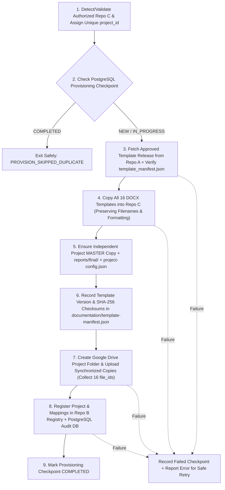

# UTDA Project Provisioning Design

## 1. Purpose

Provisioning initializes every newly authorized application repository (**Repository C**) from **Repository A (`unai-project-documentation`)**, creates its independent project-level `Master Record.docx` (`MASTER`), initializes its synchronized **Google Drive** project folder, registers the project in **Repository B (`unai-project-documentation-automation`)** and the UTDA **PostgreSQL** database, and records resumable checkpoints.

---

## 2. Trigger & Identity Model

1. **Coordinated Central Trigger:** Driven from **Repository B** via a GitHub App (`repository` organization event / dispatch) or admin `workflow_dispatch` (`provision-project.yml`). Individual application repos do not detect org-wide repository creation on their own.
2. **Authentication:** Dedicated GitHub App with least-privilege org permissions (never personal access tokens).

---

## 3. Provisioning Workflow (`engine/provisioner.py`)



---

## 4. Mapping to All 10 Provisioning Requirements

| Requirement | Design Implementation |
| --- | --- |
| **1. Assign unique `project_id`** | Generate or validate ID matching `^[A-Z0-9][A-Z0-9_-]{2,31}$`; enforce uniqueness in PostgreSQL `projects` table and `config/project_registry.json`. |
| **2. Copy all 16 DOCX templates from Repo A** | Fetch pinned Repo A release tag (e.g., `templates-v1.0.0`) and copy all 15 lifecycle docs + `Master Record.docx` into `documentation/Project Documentation/`. |
| **3. Preserve filenames, formatting & embedded objects** | Perform exact byte-for-byte binary copy (no `python-docx` re-serialization during provisioning) so tables, headers, footers, styles, and embedded objects remain untouched. |
| **4. Independent project-level `MASTER`** | Project `Master Record.docx` is an independent copy in Repo C (`document_id: "MASTER"`), isolated from `unai-company-master-record` (`COMPANY_MASTER`) and Repo A. |
| **5. Create final report directory** | Create `documentation/reports/final/.gitkeep` for canonical `<feature-id>.json` reports (+ optional `.md` companions). |
| **6. Create `project-config.json`** | Write `documentation/project-config.json` conforming to [schemas/project_config_local.schema.json](file:///c:/Users/kamal/OneDrive/Desktop/utda_starter/schemas/project_config_local.schema.json). |
| **7. Record template version & SHA-256 checksums** | Compute SHA-256 of every copied DOCX, verify against Repo A `template_manifest.json`, and write `documentation/template-manifest.json` in Repo C + PostgreSQL record. |
| **8. Register project with UTDA** | Update Repo B `config/project_registry.json` (validated vs `project_registry_collection.schema.json`) and PostgreSQL `projects` + `drive_file_mappings`. |
| **9. Create Drive folder & synchronized copies** | Create project Drive folder inside `GOOGLE_DRIVE_SHARED_DRIVE_ID` (lookup by `appProperties` first to avoid duplicates), upload the 16 GitHub-authoritative DOCX copies, and record all 16 `file_id`s + initial checksums in PostgreSQL. |
| **10. Checkpoints, idempotency & failure recovery** | Persist stage checkpoints (`TEMPLATES_VERIFIED`, `REPO_C_INITIALIZED`, `DRIVE_SYNCED`, `REGISTRY_COMMITTED`, `COMPLETED`) in PostgreSQL; retries resume only incomplete steps without duplicating folders, files, or PRs. |

---

## 5. Required Repo C Directory Structure

```text
documentation/
  Project Documentation/
    01_Project_Charter.docx
    02_Project_Plan.docx
    03_Software_Requirements_Specification.docx
    04_Business_Requirement_Document.docx
    05_Functional_Specification.docx
    06_Technical_Specification.docx
    07_Architecture_Document.docx
    08_UI_UX_Design_Document.docx
    09_Sprint_Plan.docx
    10_Test_Plan.docx
    11_Test_Cases.docx
    12_UAT_Sign_off.docx
    13_Deployment_Checklist.docx
    14_Go_Live_Checklist.docx
    15_Maintenance_Plan.docx
    Master Record.docx
  reports/
    final/
  project-config.json
  template-manifest.json
.github/
  workflows/
    utda.yml
```
