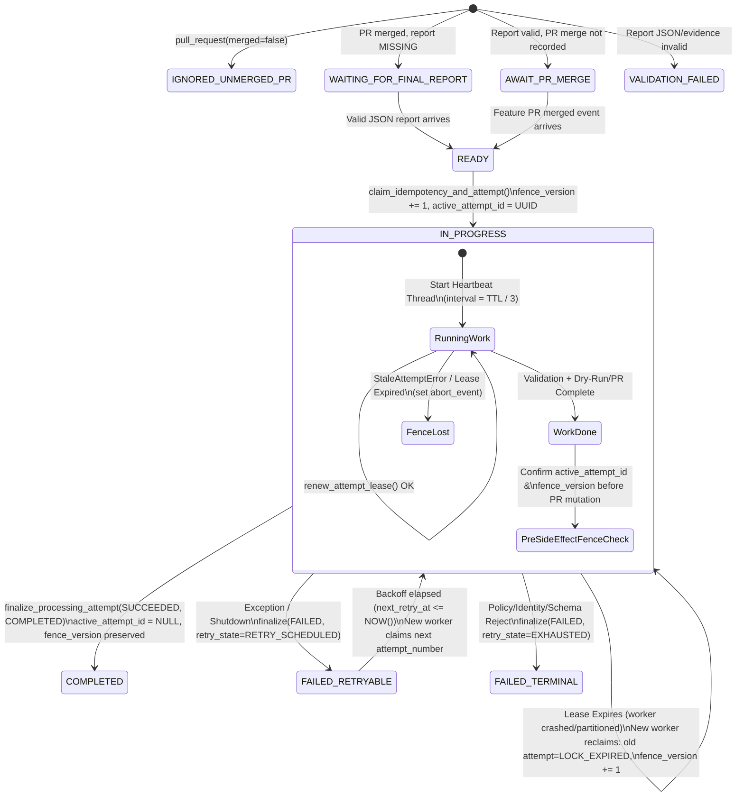

# UTDA Phase 2A — Worker Execution Model

**Document Status:** Phase 2A Design Specification (No Phase 2 Implementation Applied Yet)  
**Baseline Commit:** `c0deb74` (`engine/database.py`, `engine/migrations/0003_idempotency_fencing.sql`, `engine/migrations/0004_idempotency_fence_version_hardening.sql`)  
**Key Invariant:** Never weaken attempt fencing (`attempt_id`, `attempt_fence_version BIGINT >= 0`), immutable idempotency identity, or `CommitOutcomeUnknownError` reconciliation.

---

## 1. Purpose & Phase 1 Baseline Inventory

Phase 1 already established durable, fenced concurrency primitives in [engine/database.py](file:///c:/Users/kamal/OneDrive/Desktop/utda_starter/engine/database.py) and migrations [0003](file:///c:/Users/kamal/OneDrive/Desktop/utda_starter/engine/migrations/0003_idempotency_fencing.sql) / [0004](file:///c:/Users/kamal/OneDrive/Desktop/utda_starter/engine/migrations/0004_idempotency_fence_version_hardening.sql):
- `claim_idempotency_and_attempt(...)` — Acquires `FOR UPDATE` row lock on `utda.idempotency_keys`, verifies immutable 5-tuple request identity (`scope`, `project_id`, `feature_id`, `report_blob_sha`, `target_document_id`), allocates sequential `attempt_number` + UUID `attempt_id`, increments `attempt_fence_version` (`BIGINT >= 0`), sets `active_attempt_id` (`fk_idempotency_active_attempt`), and sets `expires_at = NOW() + lock_ttl_seconds`.
- `renew_attempt_lease(...)` — Verifies matching `active_attempt_id`, matching `expected_fence_version`, `IN_PROGRESS` status on both tables, and non-expired `expires_at` before extending `expires_at`. *(Verified in unit & PG16 tests, **not yet called periodically** by `trigger.py` or `audit_store.py` during Phase 1 synchronous correlation.)*
- `finalize_processing_attempt(...)` — Locks key row `FOR UPDATE`, verifies `IN_PROGRESS`, `active_attempt_id`, `expected_fence_version`, non-expired lease, updates `processing_attempts`, and atomically clears `active_attempt_id = NULL` with `final_key_status`.
- `DatabaseManager.transaction()` — Retries transient errors **only pre-commit**; raises `CommitOutcomeUnknownError` when a transient error occurs during `conn.commit()`.

### Identified Phase 1 $\to$ Phase 2 Gaps Addressed Here
1. **Fence Version Not Propagated in [audit_store.py](file:///c:/Users/kamal/OneDrive/Desktop/utda_starter/engine/audit_store.py#L144-L197) / [trigger.py](file:///c:/Users/kamal/OneDrive/Desktop/utda_starter/engine/trigger.py#L319-L368):** `AuditStore.claim_processing_lock()` drops `fence_version` (returning only `(claimed, attempt_no, attempt_id)`), and `AuditStore.record_attempt_outcome()` does not pass `expected_fence_version` to `finalize_processing_attempt`.
2. **No Periodic Heartbeat Loop:** Phase 2 introduces multi-second external I/O (OpenRouter LLM analysis/generation, `python-docx` patching, GitHub branch/PR API calls) that can outlive short lease TTLs.
3. **`renew_attempt_lease()` Lacks `CommitOutcomeUnknownError` Reconciliation:** Unlike `claim` and `finalize`, `renew_attempt_lease()` at [database.py](file:///c:/Users/kamal/OneDrive/Desktop/utda_starter/engine/database.py#L982) does not catch `CommitOutcomeUnknownError` to inspect whether the lease extension actually committed.
4. **`next_retry_at` Scheduling Not Yet Enforced:** `utda.processing_attempts.next_retry_at` and `idx_processing_attempts_retry` exist in `0001`/`0002`, but reclaim checks currently allow immediate takeover on `FAILED` without checking retry classification or backoff eligibility.

---

## 2. Worker Execution State Machine & End-to-End Sequence

### 2.1 Feature & Idempotency State Lifecycle



### 2.2 Concurrent Worker Fencing & Heartbeat Sequence

```mermaid
sequenceDiagram
    autonumber
    participant W1 as Worker 1 (Stalled / Timed Out)
    participant HB1 as W1 Heartbeat Thread
    participant DB as PostgreSQL (utda_runtime)
    participant W2 as Worker 2 (Recovery Worker)
    participant Ext as External (OpenRouter / GitHub PR)

    W1->>DB: claim_idempotency_and_attempt()
    DB-->>W1: claimed=True, attempt_id=A1, attempt_number=1, fence_version=1, TTL=180s

    loop Every 60s (TTL / 3) while W1 active
        HB1->>DB: renew_attempt_lease(A1, expected_fence_version=1)
        DB-->>HB1: renewed=True, expires_at=NOW()+180s
    end

    Note over W1,HB1: W1 hangs in slow network call; heartbeat fails or pauses > 180s

    W2->>DB: claim_idempotency_and_attempt() (same idempotency_key)
    Note over DB: Locks key FOR UPDATE; detects is_expired=TRUE
    DB->>DB: Retire A1 -> status=FAILED, retry_state=LOCK_EXPIRED
    DB-->>W2: claimed=True, attempt_id=A2, attempt_number=2, fence_version=2

    HB1->>DB: Delayed renew_attempt_lease(A1, expected_fence_version=1)
    DB-->>HB1: Raises StaleAttemptError (active=A2, fence=2)
    HB1->>W1: Signal abort_event.set() -> W1 aborts before GitHub PR/DB write!

    W2->>Ext: Execute OpenRouter + DOCX + Validation (with W2 Heartbeat)
    W2->>DB: renew/check fence(A2, expected_fence_version=2) before PR push
    W2->>Ext: Open Doc PR (idempotent branch utda/docs/<feature_id>)
    W2->>DB: finalize_processing_attempt(A2, expected_fence_version=2, SUCCEEDED, COMPLETED)
    DB-->>W2: active_attempt_id=NULL, status=COMPLETED, fence_version=2 preserved

    Note over W1,DB: Even if W1 ignores abort_event and tries finalizing A1:
    W1->>DB: finalize_processing_attempt(A1, expected_fence_version=1)
    DB-->>W1: Raises StaleAttemptError (key status=COMPLETED / active_attempt_id=NULL)
```

---

## 3. Attempt Claiming & Idempotency Key Granularity (Phase 2)

### 3.1 Idempotency Key Granularity Choice
- **Phase 1 Key Scope:** `make_idempotency_key(repository, feature_id, report_blob_sha, "PHASE1_CORRELATION")` (`scope="phase1_correlation"`).
- **Phase 2 Recommendation:** Retain **one run-level orchestration claim** (`scope="phase2_doc_pipeline"`, `target_document_id="ALL_IMPACTED_DOCS"`) per `(repository, feature_id, report_blob_sha)` rather than racing N separate workers per document on a single Repo C documentation PR!
  - **Why:** In `GITHUB_AUTHORITY`, all impacted documents for a feature commit (`D01`–`D15`, `MASTER`) belong to a cohesive feature documentation PR on branch `utda/docs/<feature-id>`. Parallel document workers modifying one Git branch would create Git merge/push conflicts and partial PR states. A single fenced feature-pipeline worker processes impacted documents sequentially or cleanly inside one Git branch, while preserving per-document row tracking in `utda.document_proposals`.
  - **Immutable Identity Check:** `claim_idempotency_and_attempt` preserves the 5-tuple check `(scope, project_id, feature_id, report_blob_sha, target_document_id)` raising `IdempotencyIdentityMismatchError` on collision—never relaxed.

### 3.2 Mandatory `fence_version` Propagation
Update `AuditStore.claim_processing_lock()` (Phase 2B) to return a structured `ClaimResult(claimed, attempt_id, attempt_number, fence_version, key_status)` (or keep backward-compatible helper returning `fence_version`) and require `record_attempt_outcome()` to pass `expected_fence_version=claim.fence_version` down to `finalize_processing_attempt()`.

---

## 4. Lease Renewal Heartbeat Architecture

### 4.1 Timing Budget (Aligned with 15-Minute GitHub Actions Timeout & Free Plan Compute)
- **GitHub Actions Job Timeout:** `timeout-minutes: 15` (`900s`) in [reusable-docs.yml](file:///c:/Users/kamal/OneDrive/Desktop/utda_starter/.github/workflows/reusable-docs.yml#L43).
- **Recommended Lease Parameters:**
  - `UTDA_LOCK_TTL_SECONDS = 180` (3 minutes — fast crash recovery compared to 900s static lock, without excessive DB chatter on Supabase Free Plan).
  - `UTDA_HEARTBEAT_INTERVAL_SECONDS = 60` (`TTL / 3` — provides up to 2 missed-heartbeat grace cycles before expiry).
  - **Safety Assertion:** `heartbeat_interval < lock_ttl_seconds / 2` enforced at config validation.

### 4.2 Heartbeat Execution Mechanics (Thread + Separate Pooled Connection + Abort Signal)
1. **Dedicated Background Lease Keeper (`LeaseHeartbeat` context manager):**
   - Spawned immediately after `claim_idempotency_and_attempt()` returns `claimed=True`.
   - Uses a `threading.Event` (`stop_event`) for prompt wake/exit on completion or `SIGTERM`, plus `abort_event: threading.Event` checked by the main worker before every expensive/mutating boundary:
     - Before calling OpenRouter (`impact_analyzer.py`, `ai_generator.py`),
     - Before writing `.docx` changes (`document_updater.py`),
     - Before pushing Git branch / opening or updating GitHub PR (`pr_orchestrator.py`),
     - Before calling `finalize_processing_attempt()`.
2. **Connection Pool Safety:**
   - Heartbeat calls `repo.renew_attempt_lease(...)` on **its own short-lived pooled transaction** from `DatabaseManager` (`UTDA_DATABASE_POOL_SIZE=4` leaves ample connections alongside single-threaded or stage-bounded main worker queries).
   - It must **never** share a connection object with the main worker thread.
3. **Failure Handling Inside Heartbeat:**
   - **On `StaleAttemptError`:** Fencing was definitively lost (superseded or expired). Heartbeat immediately sets `abort_event.set()`, logs structured error (`HEARTBEAT_FENCE_LOST`), and stops. Main worker aborts cleanly and exits without touching GitHub PRs or calling `finalize_processing_attempt` as succeeded.
   - **On `DatabaseUnavailableError` (transient outage exceeding `max_retries`):** If the DB cannot be reached before `deadline = last_renewed_at + lock_ttl_seconds - 10s`, heartbeat sets `abort_event.set()` proactively ("self-fencing" before another worker can legally take over at `expires_at`!) so split-brain external mutations never occur!
   - **On `CommitOutcomeUnknownError` in `renew_attempt_lease()`:** Phase 2B must add read-only reconciliation to `renew_attempt_lease()` matching `claim`/`finalize`: query `(status, active_attempt_id, attempt_fence_version, expires_at)` by `idempotency_key`; if `active_attempt_id == attempt_id`, `attempt_fence_version == expected_fence_version`, and `expires_at > NOW()`, return success cleanly; if superseded or `key_status != 'IN_PROGRESS'`, raise `StaleAttemptError`.

---

## 5. Stale-Worker Rejection & External Side-Effect Idempotency

Database fencing prevents dual `COMPLETED` commits, **but Phase 2 adds external side effects** (OpenRouter API calls and GitHub documentation branches/PRs). Even with `abort_event`, a worker could crash or lose fencing milliseconds *between* creating a GitHub PR and calling `finalize_processing_attempt()`.

### 5.1 Pre-Mutation Fencing & Check-Before-Mutate Protocol
1. **OpenRouter Calls:** Pure read/compute (stateless HTTP). Safe under `UTDA_DRY_RUN` (blocked) or duplicate execution as long as `abort_event` stops wasted spend on lease loss.
2. **GitHub Documentation Branch & PR (`pr_orchestrator.py`):**
   - **Mandatory Pre-Push Sync Check:** Immediately before pushing branch `utda/docs/<feature-id>` or calling GitHub Pulls API, execute a synchronous `renew_attempt_lease()` (validating `active_attempt_id`, `expected_fence_version`, and RLS `project_id`, and giving a fresh lease window for the PR API call). If `StaleAttemptError`, abort without calling GitHub!
   - **Idempotent Branch & PR Creation:**
     - Branch name derived deterministically from `(feature_id, report_blob_sha[:12])` or canonical `utda/docs/<feature-id>`.
     - Before `POST /pulls`, check `GET /pulls?head=<owner>:<branch>&state=open` and `utda.document_proposals` (`pr_state`, `pr_number`). If an identical PR already exists for the same `(project_id, feature_id, report_blob_sha)` with matching `post_docx_sha256`, adopt/update metadata instead of creating duplicate PRs.
   - **GitHub Actions Concurrency:** [reusable-docs.yml](file:///c:/Users/kamal/OneDrive/Desktop/utda_starter/.github/workflows/reusable-docs.yml#L37-L39) already declares `concurrency: group: utda-${{ github.repository }}-${{ inputs.project_id }}` with `cancel-in-progress: false`, preventing simultaneous GitHub runners from colliding by default while PostgreSQL fencing handles cross-trigger/manual/retry races.

---

## 6. Retry Policy & Ambiguous-Commit Reconciliation

### 6.1 Two Distinct Retry Layers (Never Mix Them)

| Layer | Trigger Condition | Action | Max Bound & Backoff |
| --- | --- | --- | --- |
| **Layer 1: Intra-Transaction Pre-Commit Retry** (`DatabaseManager.run_in_transaction`) | `psycopg.OperationalError` / `InterfaceError` occurring *before* `conn.commit()` | Automatic bounded retry with exponential backoff + jitter (`0.25 * 2^(n-1) + U(0,0.1)`, cap `5.0s`) | `UTDA_DATABASE_MAX_RETRIES = 3` (4 total attempts) |
| **Layer 1b: In-Commit Failure** (`conn.commit()` drops) | `TRANSIENT_ERRORS` when `in_commit == True` | **No blind retry!** Raises `CommitOutcomeUnknownError` $\to$ repository executes read-only reconciliation by stable primary/unique key (`receipt_id`/`delivery_id`, `attempt_id`, `(project_id, feature_id, report_blob_sha)`, `event_id`) | Single deterministic state check; retries `_op` *only* if proved uncommitted and still active; raises `StaleAttemptError` if superseded |
| **Layer 2: Job / Attempt-Level Retry** (`processing_attempts.retry_state`, `next_retry_at`) | Transient external outage (OpenRouter HTTP 429/5xx, GitHub 5xx, DB unavailable) after claiming attempt | Finalize current attempt as `FAILED` with `retry_state = 'RETRY_SCHEDULED'`, `next_retry_at = NOW() + backoff(attempt_number)` | `UTDA_MAX_WORKER_ATTEMPTS = 3` (attempts `1..3`). After attempt 3 fails $\to$ `retry_state = 'EXHAUSTED'`, alert audit log |

### 6.2 Retry Classification (Fail-Fast vs. Retryable)

- **Non-Retryable (Immediately `retry_state = 'NON_RETRYABLE'`, `final_key_status = 'FAILED'` or `'SKIPPED'`):**
  - `ConfigError` / cross-project `project_id` mismatch
  - `IdempotencyIdentityMismatchError`
  - `StaleAttemptError` (note: stale worker must **NOT** overwrite `idempotency_keys` status at all!)
  - `REPORT_VALIDATION_FAILED` / JSON schema failure / ungrounded test or deploy claims
  - `document_validator.py` policy rejection (`always_human_fields` modified or prohibited inference detected)
- **Retryable (`retry_state = 'RETRY_SCHEDULED'` with `next_retry_at`):**
  - OpenRouter 429 / 5xx / timeout
  - GitHub REST API 502/503/504 or secondary rate limit
  - `DatabaseUnavailableError`
- **Backoff Enforcement on Reclaim:** In Phase 2B, update `claim_idempotency_and_attempt` so that when `row_status == 'FAILED'`, non-manual claims respect `latest_attempt.retry_state NOT IN ('EXHAUSTED', 'NON_RETRYABLE')` and `(next_retry_at IS NULL OR next_retry_at <= NOW())`, preventing tight crash-retry storms against OpenRouter or Supabase Free Plan compute.

---

## 7. Worker Shutdown, Signal Handling & Crash Recovery

| Shutdown / Crash Mode | Behavior | Recovery Path |
| --- | --- | --- |
| **Normal Completion (`UTDA_DRY_RUN=true` or PR Created)** | Stop heartbeat thread cleanly (`stop_event.set()`, `thread.join(timeout=5)`), finalize attempt (`SUCCEEDED`, `COMPLETED`), append audit event, close `DatabaseManager` pool cleanly. | Subsequent duplicate webhooks/pushes see `key_status = 'COMPLETED'` and exit `SKIPPED_DUPLICATE`. |
| **Graceful Interrupt (`SIGTERM` / `SIGINT` / Action Cancellation)** | Signal handler sets `stop_event` and `abort_event`, halts pending external calls, attempts bounded best-effort `finalize_processing_attempt(..., attempt_status='FAILED', final_key_status='FAILED', retry_state='RETRY_SCHEDULED', error_code='WORKER_INTERRUPTED')` with `expected_fence_version`, then closes DB pool. | Next trigger or retry worker sees `FAILED` + `RETRY_SCHEDULED` and claims `attempt_number + 1`. |
| **Hard Crash (`SIGKILL`, OOM, Runner Loss, Network Partition)** | No cleanup runs; `idempotency_keys.status` stays `IN_PROGRESS` until `expires_at` (`<= 180s` with heartbeat TTL). | Once `NOW() > expires_at`, recovery worker runs `claim_idempotency_and_attempt`, atomically retires stalled attempt (`retry_state='LOCK_EXPIRED'`), increments `attempt_fence_version`, and acquires `attempt_number + 1`. |
| **Unrecoverable Mid-Write Proposal State** | Branch created in Repo C, worker crashes before `document_proposals` insert or PR creation. | Recovery worker detects existing deterministic branch `utda/docs/<feature-id>` via GitHub API, checks/creates PR idempotently, inserts/updates `document_proposals`, and finalizes `COMPLETED`. |

---

## 8. Implementation Sequence & Verification Requirements

### Required Code Changes (Phase 2B — Not Yet Implemented)
1. Expose `fence_version` in `AuditStore.claim_processing_lock()` and require `expected_fence_version` in `AuditStore.record_attempt_outcome()`.
2. Add `CommitOutcomeUnknownError` read-only reconciliation to `UTDADatabaseRepository.renew_attempt_lease()`.
3. Implement `LeaseHeartbeat` (`threading.Thread` + `stop_event` + `abort_event` + self-fencing before TTL expiry) and `SIGTERM`/`SIGINT` cleanup hooks in worker orchestration.
4. Add `next_retry_at` and `retry_state` classification enforcement in `claim_idempotency_and_attempt()` / retry scheduler (preserving backward compatibility with Phase 1 tests).
5. Enforce pre-PR synchronous fence check and idempotent branch/PR creation in `pr_orchestrator.py`.

### Required Phase 2 Worker Tests
- **Stalled-worker + Heartbeat Race (PG16):** Start Worker 1 with short TTL (`2s`) and paused heartbeat; let Worker 2 reclaim (`fence_version` increments `1 -> 2`); unpause Worker 1's heartbeat and assert `StaleAttemptError`, `abort_event.is_set() == True`, zero external PR call executed by Worker 1, and `finalize` rejection.
- **Ambiguous Lease Renewal Commit (Simulated + PG16):** Inject `CommitOutcomeUnknownError` during `renew_attempt_lease` commit and verify reconciliation succeeds when committed for active attempt and raises `StaleAttemptError` if another worker superseded the lease.
- **`SIGTERM` Shutdown Recovery:** Send interrupt mid-execution, verify heartbeat joins cleanly, lock releases to `FAILED` (`WORKER_INTERRUPTED`), and subsequent worker increments `attempt_number` cleanly.
- **Duplicate PR Prevention:** Simulate crash after branch push / PR open and before `finalize`; confirm recovery worker finds existing PR rather than opening a second PR.
