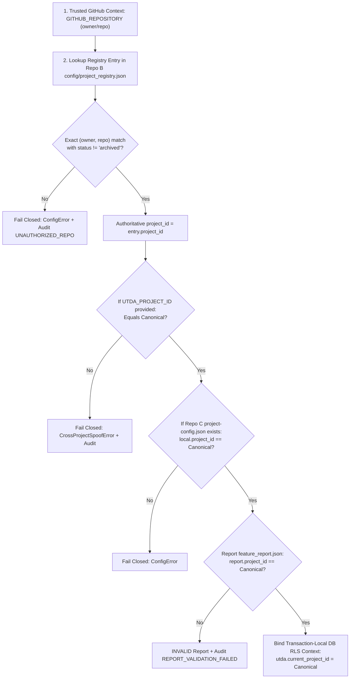

# UTDA Phase 2A — Project-Level Data Isolation Design

**Document Status:** Phase 2A Security Design (No Phase 2 Implementation or Migration `0005` Applied Yet)  
**Baseline Commit:** `c0deb74` (`engine/migrations/0001`–`0004` preserved untouched)  
**Referenced Controls:** [0002_roles_and_indexes.sql](file:///c:/Users/kamal/OneDrive/Desktop/utda_starter/engine/migrations/0002_roles_and_indexes.sql), [DATABASE_SECURITY.md](file:///c:/Users/kamal/OneDrive/Desktop/utda_starter/DATABASE_SECURITY.md), [config_loader.py](file:///c:/Users/kamal/OneDrive/Desktop/utda_starter/engine/config_loader.py), [report_parser.py](file:///c:/Users/kamal/OneDrive/Desktop/utda_starter/engine/report_parser.py)

---

## 1. Purpose & Current Gap

During Phase 1, database permissions in [0002_roles_and_indexes.sql](file:///c:/Users/kamal/OneDrive/Desktop/utda_starter/engine/migrations/0002_roles_and_indexes.sql) enforce **table-level least privilege** across `utda_runtime`, `utda_governance`, and `utda_migrator`. As documented in [POSTGRESQL_SECURITY_TEST_CHECKLIST.md](file:///c:/Users/kamal/OneDrive/Desktop/utda_starter/POSTGRESQL_SECURITY_TEST_CHECKLIST.md#L208):

> *"Current role grants are table-level; `utda_runtime` can `UPDATE` existing `utda.projects` / `utda.feature_processing_states` / `utda.idempotency_keys` rows across projects without Row-Level Security (RLS)."*

In Phase 2, central Repo B automation (`unai-project-documentation-automation`) executes document impact analysis, OpenRouter section generation, DOCX patching, and PR orchestration across **multiple registered Repo C projects** using shared infrastructure. A defect, spoofed input, or prompt-injected payload must not allow one project's workflow to read, mutate, lock, or mix context from another project.

This document specifies end-to-end project isolation across:
1. Canonical `project_id` ownership & authoritative resolution,
2. PostgreSQL Row-Level Security (RLS) vs. evaluated alternatives,
3. Database schema, pooler, and role mechanics,
4. Non-DB isolation (Git workspaces, LLM context, DOCX temp storage, CI artifacts).

---

## 2. Authoritative `project_id` Ownership & Validation Chain

### 2.1 Canonical Identifier Format & Constraints
- **Pattern:** `^[A-Z0-9][A-Z0-9_-]{2,31}$` ([project_registry.schema.json](file:///c:/Users/kamal/OneDrive/Desktop/utda_starter/schemas/project_registry.schema.json#L12-L15), [project_config_local.schema.json](file:///c:/Users/kamal/OneDrive/Desktop/utda_starter/schemas/project_config_local.schema.json#L19-L22))
- **SQL Type:** `VARCHAR(32)` Primary Key on `utda.projects(project_id)`, with uniqueness constraint `uq_projects_github_repo UNIQUE (github_owner, github_repo)` ([0001_initial_utda_schema.sql](file:///c:/Users/kamal/OneDrive/Desktop/utda_starter/engine/migrations/0001_initial_utda_schema.sql#L23-L36)).

### 2.2 Five-Point Authoritative Binding & Phase 1 Bug to Fix in Phase 2B

Currently, [config_loader.py](file:///c:/Users/kamal/OneDrive/Desktop/utda_starter/engine/config_loader.py#L70-L93) implements `resolve_project(registry, project_id=..., repository=...)` with an `if project_id:` branch that returns the registry entry matching `project_id` **without checking** whether `event.repository` matches `entry["github"]["owner"]/entry["github"]["repo"]`. Consequently, in [trigger.py](file:///c:/Users/kamal/OneDrive/Desktop/utda_starter/engine/trigger.py#L161-L166), if `UTDA_PROJECT_ID` (caller input) or `documentation/project-config.json` (Repo C editable file) names another valid `project_id`, Phase 1 lookup resolves that foreign `project_id`!

**Required Phase 2B Authoritative Binding Rule:**



- **Ownership Rule:** Only **Repo B (`config/project_registry.json`)** plus **GitHub's authenticated `GITHUB_REPOSITORY` context** establishes authoritative `(owner/repo) <-> project_id` ownership. Repo C files (`project-config.json`, `<feature-id>.json`) and workflow dispatch inputs (`UTDA_PROJECT_ID`) may **confirm**, never **override**, repository-to-`project_id` binding.

---

## 3. PostgreSQL Row-Level Security (RLS) Design & Evaluated Alternatives

### 3.1 Architecture Options Evaluated

| Option | Mechanism | Advantages | Disadvantages / Failure Modes | Verdict |
| --- | --- | --- | --- | --- |
| **Option A: App-Only `WHERE project_id = %s`** | Keep table-level grants; enforce `WHERE project_id = %s` in Python repository queries. | Zero DDL migration needed; simplest SQL. | Zero defense-in-depth at DB layer; a single omitted `WHERE` clause or raw diagnostic query leaks or corrupts foreign projects. | **Insufficient for Phase 2 multi-project automation** |
| **Option B: Per-Project PostgreSQL Roles** | Create `utda_runtime_<project_id>` role per Repo C onboarding. | Native role identity isolation in PostgreSQL. | Operational overhead in Supabase Free Plan (dynamic DBA role creation/secrets per project, secret sprawl in GitHub Environments, breaks central Repo B reusable workflow pooling). | **Rejected (Operational & Free Plan incompatibility)** |
| **Option C: Shared `utda_runtime` + Fail-Closed Session/Transaction RLS** | Enable PostgreSQL RLS on project-owned `utda.*` tables using `NULLIF(current_setting('utda.current_project_id', true), '')`, set via `SET LOCAL` inside each DB transaction; keep `utda_runtime` non-owner/no-`BYPASSRLS`. | **Zero secret sprawl; works seamlessly with `unai-utda` Free Plan & Supavisor Session/Transaction Pooler (`is_local=true`); fail-closed when GUC unset; preserves Phase 1 `utda_runtime`/`utda_governance`/`utda_migrator` model.** | Requires forward-only migration `0005` + child-table join/denormalization (`processing_attempts`, `drive_sync_revisions`) + explicit handling of pre-resolution lookup/company aggregation paths. | **SELECTED (Recommended Phase 2 Architecture)** |

### 3.2 How Option C Works Safely with Supavisor & Connection Pooling

In [engine/db_config.py](file:///c:/Users/kamal/OneDrive/Desktop/utda_starter/engine/db_config.py), UTDA supports Supavisor **Session Pooler (`port=5432`)** and optional runtime **Transaction Pooler (`port=6543`)**. Setting a session-wide `SET utda.current_project_id = '...'` would risk leaking tenant state across pooled connections if a connection were returned to Supavisor or `psycopg_pool` without reset!

Therefore, **Option C enforces strict transaction-local scoping:**
1. Every project-scoped `DatabaseManager.transaction(project_id=...)` / `run_readonly(project_id=...)` executes immediately after `SET LOCAL statement_timeout`:
   ```sql
   SELECT set_config('utda.current_project_id', %s, true);  -- is_local = true (transaction-scoped!)
   ```
   Wait: `set_config(..., is_local=true)` resets automatically when the PostgreSQL transaction commits or rolls back—guaranteed safe under both `psycopg_pool` reuse and Supavisor Transaction/Session pooling!
2. Validate `project_id` in Python (`^[A-Z0-9][A-Z0-9_-]{2,31}$`) before setting the GUC.
3. **Fail-Closed Policy Expression:**
   - Never rely on `current_setting('utda.current_project_id')` without `missing_ok = true` (which throws runtime SQL errors on non-project admin probes), and never match `NULL` or `''`!
   - Use:
     ```sql
     project_id = NULLIF(current_setting('utda.current_project_id', true), '')
     ```
   - If `utda.current_project_id` is unset or `''`, `NULLIF(...)` evaluates to `NULL`, and `project_id = NULL` is `UNKNOWN` (falsy) in SQL—so **zero rows are readable and zero writes pass `WITH CHECK`**!

### 3.3 Table-by-Table `project_id` Inventory & RLS Policy Specification (`0005`)

Every table in [0001_initial_utda_schema.sql](file:///c:/Users/kamal/OneDrive/Desktop/utda_starter/engine/migrations/0001_initial_utda_schema.sql) and [0003_idempotency_fencing.sql](file:///c:/Users/kamal/OneDrive/Desktop/utda_starter/engine/migrations/0003_idempotency_fencing.sql) falls into one of **4 isolation classes**:

#### Class 1: Direct Non-Null `project_id` Tables (Strict Equality Policy)
Tables: `projects`, `project_provisioning_runs`, `feature_processing_states`, `final_reports`, `idempotency_keys`, `document_proposals`, `approval_records`, `project_master_versions`
- **RLS Enabled** (`ALTER TABLE utda.<tbl> ENABLE ROW LEVEL SECURITY;`, **without** `FORCE` so `utda_migrator` retains backup/`pg_dump`/migration maintenance access, while `utda_runtime` and `utda_governance` are non-owners).
- **Policy for `utda_runtime`:**
  ```sql
  USING (project_id = NULLIF(current_setting('utda.current_project_id', true), ''))
  WITH CHECK (project_id = NULLIF(current_setting('utda.current_project_id', true), ''))
  ```
- **Special Note on `utda.projects`:** `utda_runtime` must only `SELECT`/`INSERT`/`UPDATE` the row matching `utda.current_project_id` during `sync_project()`. It can never read or overwrite another project's `github_owner`, `github_repo`, or `drive_folder_id`.

#### Class 2: Nullable `project_id` Operational/Audit Tables (Disallow Cross-Project + Disallow Unscoped Reads by `utda_runtime`)
Tables: `github_event_receipts`, `drive_file_mappings`, `rollback_operations`, `audit_events`
- **Finding in `0001`:** `project_id` is nullable on these four tables (`ON DELETE SET NULL` or nullable FK on `drive_file_mappings` because `COMPANY_MASTER` has `project_id IS NULL`!).
- **Runtime Policy (`utda_runtime`):**
  ```sql
  USING (project_id = NULLIF(current_setting('utda.current_project_id', true), ''))
  WITH CHECK (project_id = NULLIF(current_setting('utda.current_project_id', true), ''))
  ```
  - This ensures `utda_runtime` cannot read `COMPANY_MASTER` Drive mappings (`project_id IS NULL`), other projects' receipts, or unscoped audit logs!
  - Even if `github_event_receipts` fails pre-resolution, [trigger.py](file:///c:/Users/kamal/OneDrive/Desktop/utda_starter/engine/trigger.py#L162-L214) already resolves `project_id` *before* calling `audit.record_receipt(...)`, so `project_id` is always non-null for valid project runs! (Pre-resolution `UNAUTHORIZED_REPO` errors log to CI stderr/artifacts or governance audit with `NULL` `project_id`—never needing to pollute `github_event_receipts`.)

#### Class 3: Child Tables Currently Missing Direct `project_id` Column
Tables in `0001`:
1. `utda.processing_attempts` (links via `idempotency_key` $\to$ `utda.idempotency_keys.project_id`)
2. `utda.drive_sync_revisions` (links via `mapping_id` $\to$ `utda.drive_file_mappings.project_id`)
- **Design for `0005`:**
  - Use parent-join RLS policy for both tables (simplest without denormalization drift):
    ```sql
    -- utda.processing_attempts
    USING (
        EXISTS (
            SELECT 1 FROM utda.idempotency_keys ik
            WHERE ik.idempotency_key = processing_attempts.idempotency_key
              AND ik.project_id = NULLIF(current_setting('utda.current_project_id', true), '')
        )
    )
    WITH CHECK (
        EXISTS (
            SELECT 1 FROM utda.idempotency_keys ik
            WHERE ik.idempotency_key = processing_attempts.idempotency_key
              AND ik.project_id = NULLIF(current_setting('utda.current_project_id', true), '')
        )
    )
    ```
    *Note:* Because `idempotency_keys.idempotency_key` is a primary key and indexed, this `EXISTS` check is a single B-tree primary-key lookup (microseconds) AND automatically blocks claiming/updating an attempt on another project's `idempotency_key`!
  - Same pattern for `utda.drive_sync_revisions` via `mapping_id -> utda.drive_file_mappings(mapping_id)`.

#### Class 4: Global / Company-Wide Tables & Governance Role Exceptions
Tables: `schema_migrations`, `template_releases`, `company_aggregation_runs`
- **`schema_migrations` & `template_releases`:** Global metadata (no project secrets or per-project records). No RLS required (`utda_runtime` has `SELECT` only). Note: `engine/db_health.py --readonly-verify` queries `SELECT 1`, `pg_database_size`, and `utda.schema_migrations` without setting `utda.current_project_id` — works cleanly!
- **`utda_governance` & `company_aggregation_runs` / `project_master_versions`:**
  - `utda_governance` operates inside the reviewer-gated `utda-production` environment for:
    1. Project-scoped approvals (`approval_records`, `document_proposals`) and rollbacks (`rollback_operations`) — **must set `utda.current_project_id`** for project-level actions.
    2. Phase 5 cross-project `COMPANY_MASTER` aggregation (`unai-company-master-record`) — requires reading `eligible_for_aggregation = TRUE` rows in `project_master_versions` across active projects and writing `company_aggregation_runs` / `COMPANY_MASTER` `drive_file_mappings`.
  - **Explicit Policy Boundary for `utda_governance`:**
    ```sql
    -- Example: utda_governance cross-project read ONLY on eligible MASTER versions when aggregation scope explicitly set
    (
        NULLIF(current_setting('utda.governance_scope', true), '') = 'COMPANY_AGGREGATION'
        AND eligible_for_aggregation = TRUE
    )
    OR project_id = NULLIF(current_setting('utda.current_project_id', true), '')
    ```
    `utda_runtime` **never** honors `utda.governance_scope`; `utda_runtime` is always bound strictly to `utda.current_project_id`!

---

## 4. Handling Privileged Connections & Service Credentials

| Credential / Identity | Environment Scope | Privilege & Isolation Controls |
| --- | --- | --- |
| `UTDA_DATABASE_URL` (`utda_runtime`) | Repo B reusable workflow (`reusable-docs.yml`) for Repo C PR/report triggers | Subject to RLS (`utda.current_project_id`); zero write access to `approval_records`, `rollback_operations`, `schema_migrations`, `template_releases`; TLS `require`/`verify-full`; `sanitize_log_text` + `DatabaseConfig.__repr__` redaction. |
| `UTDA_GOVERNANCE_DATABASE_URL` (`utda_governance`) | **Strictly restricted** to protected GitHub Environment `utda-production` (manual/reviewer-gated workflows: `approval_router.py`, `rollback.py`, `master_aggregator.py`) | Never exposed to standard Repo C `pull_request`/`push` jobs or untrusted feature PR branches. Holds `SELECT, INSERT` on `approval_records`, `SELECT, INSERT, UPDATE` on `rollback_operations`. |
| `UTDA_MIGRATION_DATABASE_URL` (`utda_migrator`) | **Strictly restricted** to admin/schema-migration approval runs | Owns schema `utda` and bypasses non-`FORCE` RLS for migrations & `pg_dump`. Mandatory separate env var (`runner.py`); non-`utda_migrator` fails closed; Transaction Pooler rejected. |
| Supabase `service_role` / `postgres` / API keys (`anon`) | **Prohibited in Repo B / Repo C workflows** | `engine/db_config.py` hard-rejects `http://`/`https://`, `eyJ...`, `sb_publishable_`, `sb_secret_`. `anon`/`authenticated` explicitly revoked in `0002` and `utda` excluded from PostgREST. |
| GitHub App Installation Token (`UTDA_APP_TOKEN`) | Minted dynamically per workflow run by GitHub App | Scoped per target repository: read-only on Repo A; R/W doc branches + PRs on the single resolved Repo C `owner/repo` (or Repo D only for `master_aggregator.py`). Never use org-wide classic PATs. |
| `OPENROUTER_API_KEY` | Runtime AI steps (`impact_analyzer.py`, `ai_generator.py`) | Never logged or persisted (`API_KEY_RE` in `sanitization.py`); never passed into prompts; disabled completely when `UTDA_DRY_RUN=true` or network-disabled unit tests. |
| Google Drive Credentials (`GOOGLE_SERVICE_ACCOUNT_JSON` / OIDC) | Phase 3 provisioner & Phase 6 post-merge `drive_sync.py` only | Restricted to `GOOGLE_DRIVE_SHARED_DRIVE_ID` and `UTDA_BACKUP_FOLDER_ID`; runtime Phase 1/2 PR generation does **not** require write credentials. |

---

## 5. Non-Database Cross-Project Isolation Controls

Database RLS alone cannot stop cross-project contamination inside Python memory, disk paths, or OpenRouter prompts:

1. **Workspace & Filesystem Isolation:** `reusable-docs.yml` runs each triggered Repo C workflow in an isolated ephemeral GitHub Actions runner (`concurrency.group: utda-${{ github.repository }}-${{ inputs.project_id }}`). `UTDA_REPO_DIR` points solely to the single checked-out target Repo C; `UTDA_TEMPLATES_DIR` points to read-only Repo A. Future multi-project batch jobs (e.g., `master_aggregator.py`) must isolate per-project scratch directories (`tempfile.TemporaryDirectory(prefix=f"utda-{project_id}-")`) and verify every file path with `validate_repo_rel_path`.
2. **AI Context Isolation:** `impact_analyzer.py` and `ai_generator.py` construct prompts from an immutable `ProjectContext(project_id, repository, evidence_bundle, parsed_report, current_repo_c_docx_section)` dataclass. Zero global cache or multi-project vector/document store is permitted across requests. `document_validator.py` rejects any output JSON whose `project_id` does not equal `ctx.project_id`.
3. **Audit & Artifact Sanitization:** `AuditStore.export_artifact` and all repository methods pass JSON payloads through `sanitize_value` + `scrub_secrets` so neither project data leaks nor credential leakage occurs in uploaded workflow artifacts (`utda-run-<project_id>-<run_id>`).

---

## 6. Cross-Project Threat Matrix & Verification Tests

| Attack / Bug Vector | Isolation Layer Blocking It | Verification Test Requirement |
| --- | --- | --- |
| Caller sets `UTDA_PROJECT_ID=PROJ_B` in `org/repo-a` workflow | Layer 1 (`config_loader.resolve_project` bidirectional match) | Unit + integration test asserting `ConfigError` and zero DB writes. |
| Buggy `UTDADatabaseRepository` query runs `SELECT * FROM utda.idempotency_keys` without `WHERE project_id` | Layer 2 (PostgreSQL RLS `utda.current_project_id = 'PROJ_A'`) | PG16 live test: insert `PROJ_A` & `PROJ_B` rows; as `utda_runtime` with GUC=`PROJ_A`, `SELECT` returns only `PROJ_A`; `UPDATE`/`INSERT` targeting `PROJ_B` raises RLS violation or affects 0 rows. |
| Worker calls DB repository without initializing `utda.current_project_id` | Layer 2 (`NULLIF(..., '')` $\to$ `NULL` $\to$ fail closed) | PG16 live test: unset GUC and empty string `''` both yield 0 rows on `SELECT` and fail `WITH CHECK` on `INSERT`. |
| Supavisor / `psycopg_pool` reuses connection from `PROJ_A` transaction for `PROJ_B` or unset transaction | Layer 2 (`set_config(..., is_local=true)` resets on `COMMIT`/`ROLLBACK`) | PG16 live pool-reuse test with `pool_size=1`: `tx1(PROJ_A)` commits, `tx2(unset)` sees 0 rows; `tx3(PROJ_B)` sees only `PROJ_B`. |
| Runtime `utda_runtime` executes `SELECT set_config('utda.governance_scope', 'COMPANY_AGGREGATION', true)` to read all projects' `project_master_versions` | Layer 2 (Policy for `utda_runtime` checks **only** `utda.current_project_id`, ignoring `governance_scope`) | PG16 live test: `utda_runtime` setting `utda.governance_scope='COMPANY_AGGREGATION'` still reads 0 foreign rows. |
| Worker A attempts `finalize_processing_attempt` or `record_processing_attempt` against `PROJ_B`'s `idempotency_key` | Layer 2 (Parent-join RLS on `processing_attempts` + `idempotency_keys`) | PG16 live test: under `PROJ_A`, `processing_attempts` insert referencing `PROJ_B`'s `idempotency_key` fails RLS `WITH CHECK`. |

---

## 7. Implementation Sequence & Unresolved Decisions

### Sequence for Project Isolation (`Phase 2B`)
1. Fix `resolve_project()` in [engine/config_loader.py](file:///c:/Users/kamal/OneDrive/Desktop/utda_starter/engine/config_loader.py) and [engine/trigger.py](file:///c:/Users/kamal/OneDrive/Desktop/utda_starter/engine/trigger.py) to require exact match across `GITHUB_REPOSITORY`, `UTDA_PROJECT_ID`, and local `project-config.json`.
2. Update `DatabaseManager.transaction(project_id=...)` / `run_readonly(project_id=...)` in [engine/database.py](file:///c:/Users/kamal/OneDrive/Desktop/utda_starter/engine/database.py) to execute `SELECT set_config('utda.current_project_id', %s, true)` atomically when `project_id` is supplied, keeping global health/migration probes explicit.
3. Author forward-only migration `0005_phase2_rls_and_proposal_grants.sql` (never editing `0001`–`0004`) enabling RLS across all Class 1–3 project tables, adding parent-join RLS on `processing_attempts` & `drive_sync_revisions`, and granting scoped `INSERT`/`UPDATE` on `document_proposals` to `utda_runtime`.
4. Add full PG16 CI tests verifying pool reuse, fail-closed unset GUC, `governance_scope` rejection for `utda_runtime`, and cross-project mutation denial.

### Unresolved Decisions
1. Should `DatabaseConfig` / `DatabaseManager` reject calls to project-scoped `UTDADatabaseRepository` methods at the Python wrapper level when `project_id` is omitted, before SQL even runs? *(Recommended: Yes — require non-empty validated `project_id` on every project-scoped repository method, making Python + PostgreSQL RLS symmetric.)*
2. When an unauthorized or unregistered Repo C triggers a workflow, where should the audit record live if `github_event_receipts` RLS requires a valid `utda.current_project_id`? *(Recommended: fail closed before DB persistence if `project_id` cannot be verified, emitting a sanitized CI error log/artifact and `trigger.py` exit code `2`; optionally record into a governance-only quarantine/audit path in future if central tracking of misconfigured repos is desired.)*
